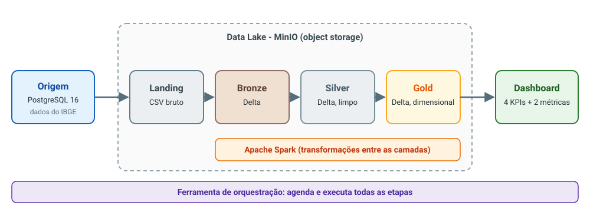

# Engenharia de Dados Aplicada a Dados Públicos do IBGE

Trabalho final da disciplina de **Engenharia de Dados** do curso de **Engenharia de Software** (5ª fase) da
**UNISATC**.

O projeto constrói um **pipeline de dados completo** sobre os **dados públicos do IBGE**: os dados são coletados
para um banco relacional de origem, copiados para um **data lake** em object storage, transformados com **Apache
Spark** nas camadas da **arquitetura medalhão** e disponibilizados em um **modelo dimensional** para consumo em um
**dashboard**.

- **Documentação (MkDocs):** <https://murilomandelli.github.io/Trabalho-final---Engenharia-de-dados-/>

## Arquitetura



| Etapa | O que acontece | Tecnologia |
|---|---|---|
| **Origem** | Banco relacional com 12 tabelas de dados reais do IBGE | PostgreSQL 16 |
| **Landing** | Cópia bruta das tabelas da origem, no formato original | CSV no MinIO |
| **Bronze** | Mesmos dados da landing, gravados em Delta | Spark + Delta Lake |
| **Silver** | Dados limpos, tipados e padronizados | Spark + Delta Lake |
| **Gold** | Modelo dimensional (fatos e dimensões) | Spark + Delta Lake |
| **Dashboard** | One Page View com 4 KPIs e 2 métricas | Streamlit |

## Fonte dos dados

Dados públicos do IBGE, coletados das APIs oficiais:

- [IBGE](https://www.ibge.gov.br/)
- [API de serviços de dados](https://servicodados.ibge.gov.br/api/docs)
- [SIDRA](https://sidra.ibge.gov.br/)

As pesquisas usadas são: municípios, IPCA, INPC, PIB dos municípios, população estimada, produção agrícola,
rebanhos, produção de origem animal e PNAD Contínua (microdados).

## Estrutura do projeto

| Pasta | Conteúdo |
|---|---|
| `origem/` | Banco de origem (PostgreSQL), scripts de carga e consultas de validação |
| `scripts/` | Notebooks do pipeline: criação dos buckets, landing, bronze, silver e gold |
| `dashboard/` | Dashboard em Streamlit que consome a camada gold |
| `docs/` | Documentação publicada no MkDocs |

## Como executar

Pré-requisitos: Docker e Docker Compose.

**1. Subir a infraestrutura** (PostgreSQL, MinIO e o dashboard):

```bash
cp origem/.env.example origem/.env
docker compose up -d
```

Na primeira vez, o PostgreSQL restaura automaticamente o banco de origem a partir do dump.

**2. Rodar o pipeline** para popular o data lake, executando os notebooks de `scripts/` nesta ordem:

1. `Create_buckets.ipynb`
2. `Feed_Landing.ipynb`
3. `Implement_bronze.ipynb`
4. `Implement_silver.ipynb`
5. `Implement_gold.ipynb`

**3. Abrir o dashboard** em <http://localhost:8501>.

Os detalhes de cada etapa estão na [documentação](https://murilomandelli.github.io/Trabalho-final---Engenharia-de-dados-/).

## Equipe

| Integrante |
|---|
| André Cittadin |
| Augusto Benedetti |
| Jorge Antônio |
| Murilo Mandelli |
| Realdo Justino Junior |

## Disciplina

| | |
|---|---|
| **Instituição** | UNISATC |
| **Curso** | Engenharia de Software — 5ª fase |
| **Disciplina** | Engenharia de Dados |
| **Professor** | Jorge Luiz da Silva |
| **Semestre** | 2026/2 |

## Fluxo de trabalho

As alterações entram na `main` por **Pull Request** com aprovação da equipe, e cada tarefa é registrada em uma
**issue**.

## Referências

- SILVA, Jorge Luiz da. *Projeto modelo de Engenharia de Dados — SATC*. Disponível em: <https://github.com/jlsilva01/projeto-ed-satc>.
- IBGE. *API de serviços de dados*. Disponível em: <https://servicodados.ibge.gov.br/api/docs>.
- Delta Lake. *Documentação oficial*. Disponível em: <https://docs.delta.io/>.
- Apache Spark. *Documentação oficial*. Disponível em: <https://spark.apache.org/docs/latest/>.
- Material for MkDocs. *Documentação oficial*. Disponível em: <https://squidfunk.github.io/mkdocs-material/>.
