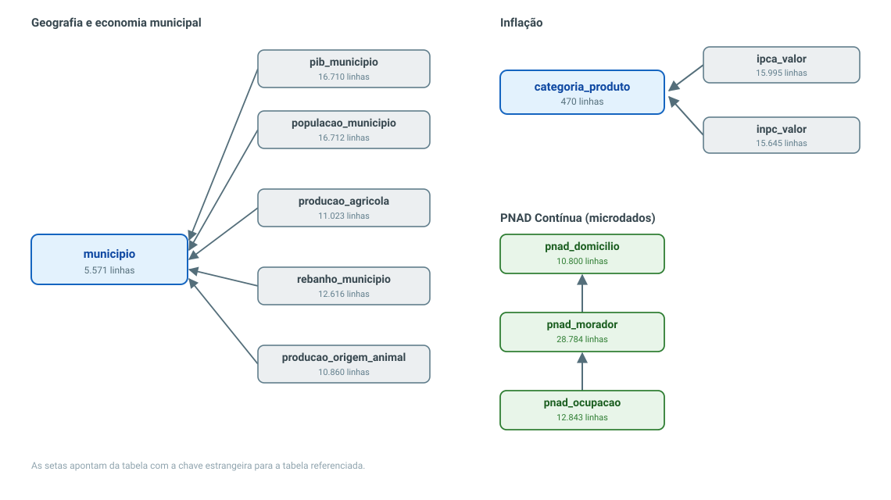

# Banco de origem

O ponto de partida do pipeline é um banco relacional **PostgreSQL 16** com dados
reais do IBGE, rodando em Docker. Ele tem **12 tabelas** e serve de origem para a
ingestão no data lake.

## Fonte dos dados

Todos os dados são públicos e foram coletados das APIs oficiais do IBGE:

| Pesquisa | Tabelas no banco | Origem |
|---|---|---|
| Municípios e divisão territorial | `municipio` | [API de Localidades](https://servicodados.ibge.gov.br/api/docs/localidades) |
| IPCA e INPC | `ipca_valor`, `inpc_valor`, `categoria_produto` | SIDRA (agregados 7060 e 7063) |
| População estimada | `populacao_municipio` | SIDRA (agregado 6579) |
| PIB dos municípios | `pib_municipio` | SIDRA (agregado 5938) |
| Produção agrícola, pecuária e origem animal | `producao_agricola`, `rebanho_municipio`, `producao_origem_animal` | SIDRA (agregados 5457, 3939 e 74) |
| PNAD Contínua (microdados) | `pnad_domicilio`, `pnad_morador`, `pnad_ocupacao` | [PNAD Contínua](https://www.ibge.gov.br/estatisticas/sociais/trabalho/9173-pesquisa-nacional-por-amostra-de-domicilios-continua-trimestral.html) |

Portais: [IBGE](https://www.ibge.gov.br/) ·
[API de serviços](https://servicodados.ibge.gov.br/api/docs) ·
[SIDRA](https://sidra.ibge.gov.br/).

## Diagrama do modelo

O diagrama abaixo mostra as 12 tabelas e as chaves estrangeiras entre elas.



O diagrama é gerado a partir do **banco real**: o script
`origem/scripts/gerar_dbml.py` lê as tabelas e as chaves direto do PostgreSQL e
escreve o arquivo `origem/modelo_origem.dbml`. Esse arquivo pode ser colado em
[dbdiagram.io](https://dbdiagram.io/d) para visualizar e exportar o modelo.

```bash
cd origem
python scripts/gerar_dbml.py
```

## Validação do banco

As consultas de verificação estão em `origem/consultas/validacao.sql`.

### Consulta 1 — linhas por tabela

| Tabela | Linhas |
|---|---:|
| pnad_morador | 28.784 |
| populacao_municipio | 16.712 |
| pib_municipio | 16.710 |
| ipca_valor | 15.995 |
| inpc_valor | 15.645 |
| pnad_ocupacao | 12.843 |
| rebanho_municipio | 12.616 |
| producao_agricola | 11.023 |
| producao_origem_animal | 10.860 |
| pnad_domicilio | 10.800 |
| municipio | 5.571 |
| categoria_produto | 470 |

O enunciado pede pelo menos **10 mil linhas** nas tabelas principais.
**10 das 12 tabelas (83%) atendem esse mínimo.** As duas menores são tabelas de
cadastro: `municipio` (os 5.570 municípios do país) e `categoria_produto` (os
itens do IPCA/INPC).

### Consulta 2 — distribuição de datas (últimos 3 anos)

| Pesquisa | Período coberto |
|---|---|
| IPCA e INPC | 11/2023 a 09/2026 (mensal) |
| PIB dos municípios | 2021 a 2023 |
| População estimada | 2024 a 2026 |
| Produção agrícola, rebanhos e origem animal | 2023 a 2025 |
| PNAD Contínua | 2º tri/2024 a 2º tri/2026 |

Cada pesquisa do IBGE tem uma defasagem diferente de divulgação (o PIB municipal,
por exemplo, sai com cerca de dois anos de atraso), mas todas as séries ficam
dentro da janela dos últimos três anos.

## Normalização

O banco foi modelado na **3ª forma normal**:

- **`municipio`** é a tabela de referência geográfica. As demais tabelas de
  dados municipais (PIB, população, produção agrícola, rebanhos e produção de
  origem animal) apontam para ela por `municipio_id`, em vez de repetir nome da
  cidade, UF e região em cada linha.
- **`categoria_produto`** guarda os itens do IPCA e do INPC uma única vez;
  `ipca_valor` e `inpc_valor` referenciam `categoria_id`.
- A **PNAD** foi normalizada em três níveis encadeados: `pnad_domicilio` →
  `pnad_morador` → `pnad_ocupacao`, cada um com sua chave e ligados por chave
  estrangeira, evitando repetir os dados do domicílio em cada morador.

Com isso, cada informação fica guardada em um só lugar, e as chaves estrangeiras
garantem a integridade entre as tabelas.

## Como subir o banco

Pré-requisito: Docker e Docker Compose instalados.

```bash
cd origem
cp .env.example .env
docker compose up -d
```

Na primeira vez que sobe, o container restaura automaticamente o dump
`origem/sql/02_banco_completo.sql.gz`, já com todos os dados. Para recriar o
banco do zero:

```bash
docker compose down -v
docker compose up -d
```
