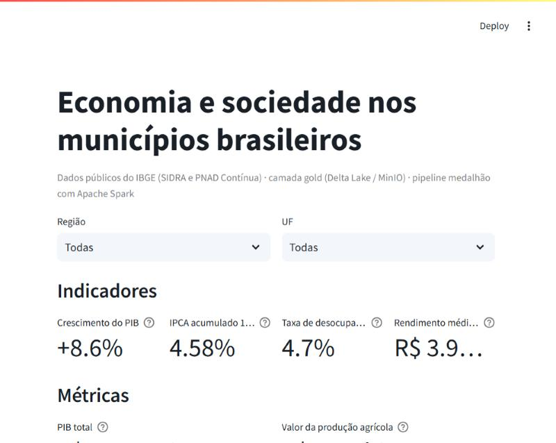
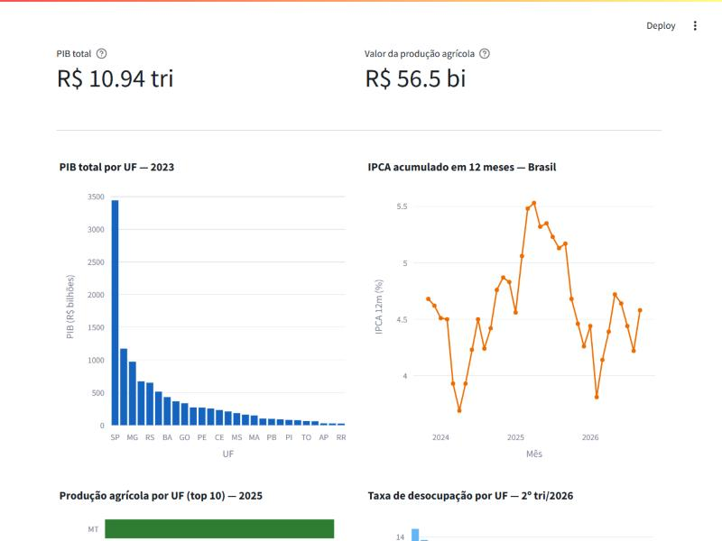

# Dashboard

O dashboard é a ponta final do pipeline. Ele é uma visão de **uma página**
(One Page View) que lê as tabelas da **camada gold** (Delta Lake) direto do
MinIO e mostra 4 KPIs, 2 métricas e os gráficos.

Foi feito em **Python com Streamlit**, usando a biblioteca `deltalake` para ler
as tabelas Delta sem precisar de Spark na visualização.

## Indicadores



**KPIs**

1. **Crescimento do PIB** — variação do PIB total de um ano para o outro
   (`economia_municipal`).
2. **IPCA acumulado em 12 meses** — índice geral, Brasil, último mês disponível
   (`inflacao`).
3. **Taxa de desocupação** — desocupados sobre a força de trabalho, pela PNAD
   Contínua (`mercado_trabalho`).
4. **Rendimento médio do trabalho** — rendimento habitual médio dos ocupados
   (`mercado_trabalho`).

**Métricas**

1. **PIB total** (`economia_municipal`).
2. **Valor da produção agrícola** (`agropecuaria_municipal`).

Há filtros por **região** e **UF**, que as tabelas municipais compartilham.

## Gráficos



- **PIB total por UF**
- **IPCA acumulado em 12 meses** ao longo do tempo
- **Produção agrícola por UF**
- **Taxa de desocupação por UF**

## De onde vêm os indicadores

O dashboard consome as quatro tabelas da camada gold:

| Tabela gold | Usada em |
|---|---|
| `economia_municipal` | crescimento do PIB, PIB total, PIB por UF |
| `inflacao` | IPCA 12 meses |
| `mercado_trabalho` | taxa de desocupação, rendimento médio |
| `agropecuaria_municipal` | valor da produção agrícola |

## Como executar

Pré-requisito: o pipeline já precisa ter sido executado (buckets → landing →
bronze → silver → gold), com o MinIO no ar via `docker compose up -d` na raiz do
projeto.

```bash
cd dashboard
pip install -r requirements.txt
streamlit run app.py
```

O dashboard abre em `http://localhost:8501`.

## Observação sobre os períodos

As pesquisas do IBGE têm defasagens diferentes de divulgação: o PIB municipal vai
até 2023, a produção agrícola até 2025 e a PNAD até 2026. Por isso cada indicador
é mostrado no seu período mais recente disponível.
