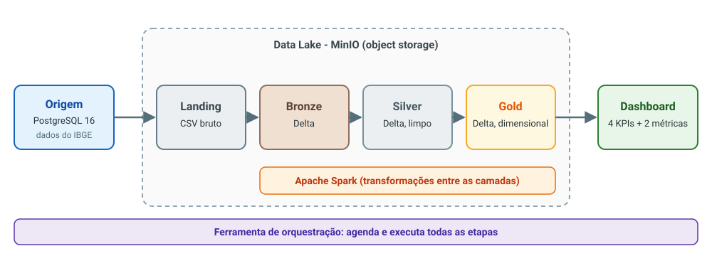

---
hide:
  - navigation
---

# Engenharia de Dados Aplicada a Dados Públicos do IBGE

Trabalho final da disciplina de **Engenharia de Dados** do curso de Engenharia de Software da **UNISATC**.

O projeto constrói um **pipeline de dados completo**: os dados públicos do IBGE são coletados para um banco
relacional de origem, copiados para um **Data Lake** em object storage, transformados com **Apache Spark** nas
camadas da **arquitetura medalhão** e disponibilizados em um **modelo dimensional** para consumo em um
**dashboard**.

## Arquitetura

| Etapa | O que acontece | Tecnologia |
|---|---|---|
| **Origem** | Banco relacional com dados reais do IBGE (municípios, população, PIB, inflação, produção agrícola, PNAD Contínua) | PostgreSQL 16 (Docker) |
| **Landing** | Cópia bruta das tabelas da origem, no formato original | CSV no MinIO |
| **Bronze** | Mesmos dados da landing, gravados em formato Delta | Spark + Delta Lake |
| **Silver** | Dados limpos, tipados e padronizados | Spark + Delta Lake |
| **Gold** | Modelo dimensional (fatos e dimensões SCD tipo 2) | Spark + Delta Lake |
| **Dashboard** | One Page View com 4 KPIs e 2 métricas | A definir |

!!! info "Orquestração"

    Todas as etapas de ingestão e transformação são executadas por uma ferramenta de orquestração de
    tarefas (não é usado cron nem o agendador do Windows).

## Fonte dos dados

Todos os dados são públicos e obtidos pelas APIs oficiais do IBGE:

- [Portal do IBGE](https://www.ibge.gov.br/)
- [API de serviços de dados do IBGE](https://servicodados.ibge.gov.br/api/docs)
- [SIDRA - Sistema IBGE de Recuperação Automática](https://sidra.ibge.gov.br/)

## Repositório

O código-fonte está no [GitHub](https://github.com/MuriloMandelli/Trabalho-final---Engenharia-de-dados-).
Todas as alterações entram na branch `main` por **Pull Request** com aprovação, e cada tarefa é registrada em uma
**issue**.

## Referências

- SILVA, Jorge Luiz da. *Projeto modelo de Engenharia de Dados - SATC*. Disponível em: <https://github.com/jlsilva01/projeto-ed-satc>.
- IBGE. *API de serviços de dados*. Disponível em: <https://servicodados.ibge.gov.br/api/docs>.
- MkDocs. *Documentação oficial*. Disponível em: <https://www.mkdocs.org/>.
- Material for MkDocs. *Documentação oficial*. Disponível em: <https://squidfunk.github.io/mkdocs-material/>.
- Delta Lake. *Documentação oficial*. Disponível em: <https://docs.delta.io/>.
- Apache Spark. *Documentação oficial*. Disponível em: <https://spark.apache.org/docs/latest/>.
